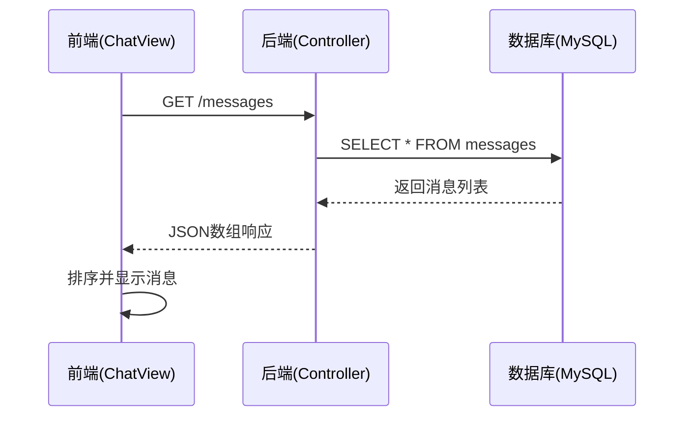
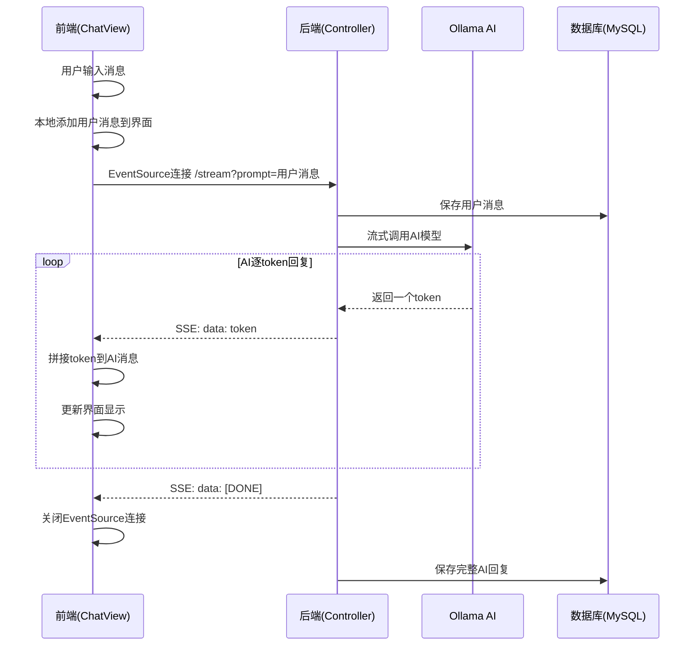

# 前端后端连接与数据传递流程详解

## 📡 整体架构图

```
┌─────────────────┐     HTTP请求      ┌─────────────────┐
│   Vue 3 前端    │ ◄──────────────► │ Spring Boot后端  │
│ localhost:5173  │                  │ localhost:8080   │
│                 │     SSE流式      │                 │
│  - ChatView     │ ◄──────────────► │ MessageController│
│  - axios        │                  │                 │
│  - EventSource  │                  │ - Ollama AI     │
│                 │                  │ - MySQL Database│
└─────────────────┘                  └─────────────────┘
```

## 🔌 连接方式详解

### 1. **HTTP连接配置**

#### 前端配置
```javascript
// 方式1: 直接使用axios (当前采用)
const response = await axios.get("http://localhost:8080/messages");

// 方式2: 使用配置好的api实例 (备用)
const api = axios.create({
  baseURL: 'http://localhost:8080',
  timeout: 30000
})
```

#### 后端CORS配置
```java
@CrossOrigin(origins = "*") // 允许所有域访问
@RestController
@RequestMapping("")
public class MessageController {
    // ...
}
```

### 2. **端口和地址**
- **前端**: `http://localhost:5173` (Vite默认端口)
- **后端**: `http://localhost:8080` (Spring Boot默认端口)
- **跨域**: 通过 `@CrossOrigin` 注解解决

## 📊 数据传递流程

### 流程1: 页面加载 - 获取历史消息



#### 代码实现
```javascript
// 前端发送请求
const loadHistory = async () => {
  try {
    const response = await axios.get("http://localhost:8080/messages");
    messages.value = response.data.sort((a, b) => new Date(a.created_at) - new Date(b.created_at));
    await nextTick()
    scrollToBottom()
  } catch (error) {
    console.error("获取历史消息失败:", error);
  }
};
```

```java
// 后端处理请求
@GetMapping("/messages")
public List<Message> getMessages() {
    return messageService.list(); // MyBatis-Plus的基础查询
}
```

#### 数据格式
```json
[
  {
    "id": 1,
    "sender": "user",
    "content": "你好",
    "createdAt": "2024-08-25 15:30:00"
  },
  {
    "id": 2,
    "sender": "assistant", 
    "content": "你好！有什么可以帮助你的吗？",
    "createdAt": "2024-08-25 15:30:05"
  }
]
```

### 流程2: 发送消息 - 流式AI回复



#### 前端流式接收代码
```javascript
const sendMessage = () => {
  // 1. 本地添加用户消息
  const userMsg = { sender: "user", content: inputMessage.value }
  messages.value.push(userMsg)
  
  // 2. 创建空的AI消息容器
  const botMsg = { sender: "bot", content: "" }
  messages.value.push(botMsg)
  
  // 3. 建立SSE连接
  const eventSource = new EventSource(`http://localhost:8080/stream?prompt=${encodeURIComponent(userText)}`)
  
  // 4. 监听流式数据
  eventSource.onmessage = (event) => {
    if (event.data === '[DONE]') {
      eventSource.close()
      return
    }
    
    let token = event.data
    
    // 智能添加空格处理
    if (botMsg.content && 
        /^[a-zA-Z]/.test(token) && 
        !/[\s\n>]$/.test(botMsg.content) &&
        !/^[<]/.test(token)) {
      token = ' ' + token
    }
    
    botMsg.content += token // 拼接内容
    messages.value = [...messages.value] // 触发响应式更新
    nextTick(() => scrollToBottom()) // 滚动到底部
  }
}
```

#### 后端流式响应代码
```java
@GetMapping(value = "/stream", produces = MediaType.TEXT_EVENT_STREAM_VALUE)
public Flux<ServerSentEvent<String>> chat(@RequestParam String prompt) {
    // 1. 保存用户消息
    Message userMsg = new Message("user", prompt);
    messageService.save(userMsg);
    
    StringBuilder aiResponseBuilder = new StringBuilder();
    
    // 2. 调用AI并流式返回
    return ollamaChatModel.stream(prompt).map(token -> {
        aiResponseBuilder.append(token);
        return ServerSentEvent.builder(token).event("message").build();
    }).concatWith(
        Flux.just(ServerSentEvent.builder("[DONE]").event("message").build())
    ).doOnComplete(() -> {
        // 3. 保存完整AI回复
        Message aiMsg = new Message("assistant", aiResponseBuilder.toString());
        messageService.save(aiMsg);
    });
}
```

## 🔄 数据流转详细分析

### 1. **HTTP请求/响应模式** (历史消息)
```
前端 → axios → HTTP GET → 后端Controller → Service → Mapper → 数据库
                                                                    ↓
前端 ← JSON响应 ← HTTP 200 ← 后端Controller ← Service ← Mapper ← 数据库
```

### 2. **Server-Sent Events模式** (流式聊天)
```
前端 → EventSource → HTTP GET → 后端Controller → Ollama AI
  ↑                                       ↓
  └── SSE data: token ←─────────────────── Flux<ServerSentEvent>
```

### 3. **数据库操作模式**
```
后端Controller → MessageService.save() → MyBatis-Plus → MySQL
                                           ↓
                          INSERT INTO messages (sender, content, created_at)
```

## 📦 数据格式标准化

### 前端数据结构
```javascript
// Vue响应式数据
const messages = ref([
  {
    sender: "user",          // 发送者类型
    content: "用户消息内容", // 消息内容
    createdAt: "时间戳"      // 创建时间(可选)
  }
])
```

### 后端数据结构
```java
// Message实体类
public class Message {
    private Long id;              // 数据库主键
    private String sender;        // "user" 或 "assistant"
    private String content;       // 消息内容
    private LocalDateTime createdAt; // 创建时间
}
```

### SSE数据格式
```
event: message
data: Hello

event: message  
data: !

event: message
data:  How

event: message
data: [DONE]
```

## 🛠️ 错误处理机制

### 前端错误处理
```javascript
// HTTP请求错误
try {
  const response = await axios.get("http://localhost:8080/messages");
} catch (error) {
  console.error("获取历史消息失败:", error);
}

// SSE连接错误
eventSource.onerror = () => {
  eventSource.close()
  // 可以在这里添加重连逻辑
}
```

### 后端错误处理
```java
// 跨域配置
@CrossOrigin(origins = "*")

// 异常时自动关闭流
.doOnError(error -> {
    log.error("流式响应异常", error);
})
```

## ⚡ 性能优化策略

### 前端优化
1. **响应式更新**: `messages.value = [...messages.value]`
2. **DOM更新**: `nextTick(() => scrollToBottom())`  
3. **连接管理**: 自动关闭EventSource防止内存泄漏
4. **空格智能处理**: 前端处理token拼接问题

### 后端优化
1. **流式响应**: 使用Reactor Flux避免阻塞
2. **连接复用**: Spring Boot自动管理连接池
3. **异步保存**: 流结束后异步保存到数据库
4. **跨域配置**: 一次配置全局生效

## 🔍 调试和监控

### 前端调试
```javascript
// 在浏览器控制台查看
console.log('Token:', JSON.stringify(event.data))  // SSE数据
console.log('Messages:', messages.value)           // 消息状态
```

### 后端调试
```java
// 可以添加日志输出
System.out.println("收到请求: " + prompt);
System.out.println("AI响应: " + token);
```

### 网络调试
- **F12 → Network**: 查看HTTP请求
- **F12 → EventStream**: 查看SSE连接状态
- **curl测试**: `curl "http://localhost:8080/stream?prompt=测试"`

## 📋 总结

这个前后端连接方案的特点：

✅ **简洁高效**: 直接使用原生API，无复杂封装
✅ **实时体验**: SSE流式传输，逐字符显示
✅ **错误恢复**: 完善的错误处理和连接管理  
✅ **数据一致**: 前后端数据结构统一
✅ **性能优良**: 响应式更新，异步处理
✅ **易于调试**: 清晰的数据流和错误信息

这种架构既保证了用户体验，又维持了代码的简洁性和可维护性。
